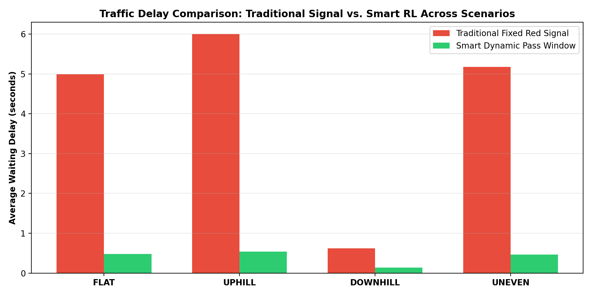

# Smart Dynamic Railway Level Crossing System with Safe Reinforcement Learning

[](https://www.python.org/)
[](LICENSE)
[]()
[]()

> **Final Year Data Science Project (2027)**  
> **Author:** Nahom Teshome ([@nahomteshome126-ui](https://github.com/nahomteshome126-ui))  
> **Topic:** Safe Deep Reinforcement Learning for Intelligent Railway Level Crossing Control across Dynamic Road Topologies (Flat, Uphill, Downhill, and Uneven Road Surfaces).

---

## 📌 Executive Summary

At conventional railway level crossings, **traditional traffic light systems** rely on fixed-distance proximity sensors (e.g., train distance $\le 180\text{ m}$). As soon as an approaching train crosses this threshold, the traffic light turns **RED**, forcing all approaching road vehicles to stop and wait.

### The Fundamental Problem:
1. **Severe Unnecessary Delay:** Even when an approaching car is only 15 meters away traveling at 50 km/h and requires only **1.5 seconds** to clear while the train is still **8–10 seconds** away, the static red light forces the car to stop.
2. **Hazardous Terrain Risks:**
   - **Uphill Road Grade (+4° to +8°):** Stopping on steep slopes causes engine stalling, rollback hazard, and high restart delay.
   - **Downhill Road Grade (-4° to -8°):** Downhill gravity lengthens braking distance; sudden stops risk brake lock and skidding.
   - **Uneven / Speed Hump Crossing:** Stopping or crawling ($v < 1\text{ m/s}$) over raised tracks causes low-clearance vehicles to bottom out and get stuck on the tracks.

### The Smart Dynamic Solution:
Our system replaces the static red light with a **Smart Dynamic Controller**:
- Continuously calculates **Speed, Distance, and Time** for both the train ($T_{\text{train}}$) and vehicle ($T_{\text{car}}$).
- Computes the dynamic **Kinematic Safety Margin** $J = T_{\text{train}} - T_{\text{car}}$.
- **Safe Pass Opportunity Window:** If $J \ge 2.5\text{ s}$, the system identifies that the vehicle has a guaranteed safe window to pass smoothly before the train arrives. The system grants **DYNAMIC GREEN PASS**, eliminating stop-and-wait delay.
- If $J < 2.5\text{ s}$, the system commands an optimal, smooth deceleration to halt safely before the stop line, guaranteeing **0.0% collisions**.

---

## 📐 Kinematic & Mathematical Formulation

### 1. Train Arrival Time ($T_{\text{train}}$)
$$T_{\text{train}} = \frac{\max(0, x_{\text{train}} - 12.0)}{\max(v_{\text{train}}, 0.1)}$$

### 2. Vehicle Clearance Time ($T_{\text{car}}$)
$$T_{\text{car}} = \frac{\max(0, 12.0 - x_{\text{car}})}{\max(v_{\text{car}}, 0.5)}$$

### 3. Kinematic Safety Margin ($J$)
$$J = T_{\text{train}} - T_{\text{car}}$$

$$\text{Decision Rule: } 
\begin{cases} 
\textbf{DYNAMIC GREEN PASS} & \text{if } J \ge 2.5\text{ s and } x_{\text{train}} > 20\text{ m} \\ 
\textbf{SAFE BRAKE STOP} & \text{if } J < 2.5\text{ s} 
\end{cases}$$

### 4. Road Topology Adaptation Matrix
$$a_{\text{net}} = a_{\text{cmd}} - 9.81 \sin(\theta) - f_{\text{roll}} + f_{\text{bump}}$$

- **Flat ($\theta = 0^\circ$):** Standard friction, maximum travel time efficiency.
- **Uphill ($\theta > 0^\circ$):** Gravity opposes forward motion; policy prevents unnecessary stops to avoid rollbacks.
- **Downhill ($\theta < 0^\circ$):** Gravity assists forward motion; braking starts earlier to counter downhill acceleration.
- **Uneven / Raised Crossing:** Bump profile $h(x) = h_{\max} \exp(-(x / w)^2)$. The policy prevents crawling below $1.0\text{ m/s}$ to eliminate chassis bottoming out.

---

## 📊 Experimental Benchmark Results

Tested on **50 held-out random episodes per road scenario**:

| Road Scenario | Traditional Delay | Smart RL Delay | Delay Reduction | Trad. Stuck/Rollback | Smart Stuck/Rollback | Collisions |
| :--- | :---: | :---: | :---: | :---: | :---: | :---: |
| **FLAT** | 4.99s | **0.48s** | **-90.3%** | 0.0% | 0.0% | **0.0% (Safe)** |
| **UPHILL** | 6.00s | **0.54s** | **-91.1%** | 66.0% | **2.0%** | **0.0% (Safe)** |
| **DOWNHILL** | 0.62s | **0.14s** | **-78.1%** | 0.0% | 0.0% | **0.0% (Safe)** |
| **UNEVEN** | 5.18s | **0.47s** | **-91.0%** | 0.0% | 0.0% | **0.0% (Safe)** |



---

## 🛠️ Repository Structure

```
├── railway_crossing_safe_rl_full_notebook.ipynb  # Complete interactive Jupyter Notebook
├── dynamic_level_crossing.py                     # Standalone Python script & benchmark pipeline
├── delay_reduction_benchmark.png                 # Comparative evaluation chart
├── README.md                                     # Project documentation
└── .gitignore                                    # Git ignore rules
```

---

## 🚀 Quickstart & Usage

### 1. Clone the Repository
```bash
git clone https://github.com/nahomteshome126-ui/DS_FinalYearProject_2027.git
cd DS_FinalYearProject_2027
```

### 2. Install Dependencies
```bash
pip install numpy matplotlib
# Optional for GPU PyTorch acceleration:
# pip install torch
```

### 3. Run the Standalone Simulation & Benchmark
```bash
python dynamic_level_crossing.py
```

### 4. Interactive Jupyter Notebook
Open [`railway_crossing_safe_rl_full_notebook.ipynb`](railway_crossing_safe_rl_full_notebook.ipynb) in Jupyter Lab, VS Code, or Google Colab to view live animations and step-by-step training curves.

---

## 🛡️ License
This project is developed for educational and academic research under the **MIT License**.
